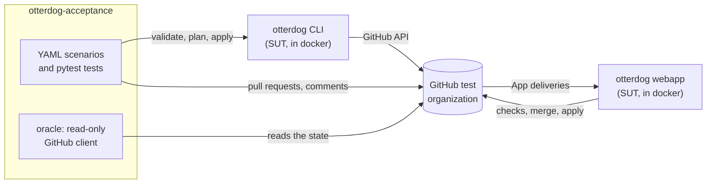
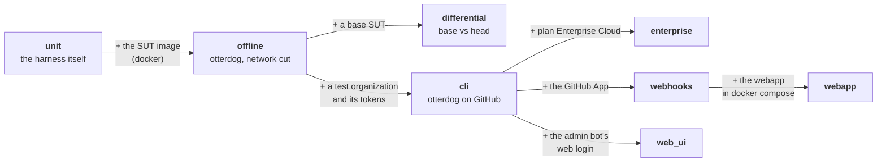

# Otterdog Acceptance

<!-- github-only -->

[](https://github.com/heurtematte/otterdog-e2e/actions/workflows/docs.yml)

Documentation: https://heurtematte.github.io/otterdog-e2e/

<!-- /github-only -->

End-to-end test harness for [otterdog](https://github.com/eclipse-csi/otterdog), the GitOps tool that manages GitHub
organizations as code. It runs otterdog against **real, dedicated GitHub test organizations** and checks what GitHub
really holds afterwards, for the three faces of otterdog:

- the **CLI** (`validate`, `plan`, `apply`, `import`, `push-config`, `open-pr`, ...),
- the **webapp** (Quart application + GitHub App) and its config-repository pull request workflow (validation
  status and comments, `/otterdog` commands, approvals, auto-merge, merge then apply, sync checks),
- **webhooks**: deliveries to the GitHub App receiver and the org/repository webhooks that otterdog manages.

It tests a released otterdog version, upstream `main`, an upstream pull request pinned to a commit or a local checkout
(uncommitted changes included). For a pull request it also runs base and head side by side and reports the expected
and unexpected differences.

## How it works



A live test writes an otterdog configuration (the baseline of the organization plus what the test adds), runs the SUT
(the *system under test*, the otterdog version being tested) and reads the organization back through the **oracle**, a
GitHub client independent of otterdog, to check what GitHub really did. It then plans again until otterdog sees no
change (convergence). The webapp tests act as GitHub users: they open pull requests on the organization's config
repository, comment and approve, and the GitHub App's deliveries reach the webapp under test through a relay. Every
object a run creates carries its run id (`e2e-<run>-...`); each run starts from a baseline of the organization and
removes what it created.

> [!WARNING]
> Only use **dedicated test organizations** and **dedicated machine accounts** that belong to test organizations
> only. The harness creates, changes and deletes repositories, teams, secrets, webhooks and rulesets. It verifies the
> organization id, its plan, a marker in its description and the memberships of every account before it writes
> anything, but these checks only protect you if the accounts cannot reach any real organization.
> See [docs/security.md](docs/security.md).

## Tiers

A **tier** is a family of tests that need the same environment, from nothing at all to a GitHub organization with
the GitHub App and the admin bot's web login. Each tier is a directory of `tests/` (YAML scenarios also live in
`scenarios/offline`, `scenarios/cli` and `scenarios/enterprise`), a `--suite` value of `otterdog-acceptance run` and a
`make` target. Each arrow reads "needs what the tier on its left needs, plus":



| Tier | What it checks | Run it |
|---|---|---|
| unit | the harness itself: parsers, guards, renderers and the scenario engine on fakes (no network, no docker) | `make unit` |
| offline | otterdog without GitHub, with a vendored template: configuration loading, credential providers, `validate`, `local-plan`, `show`, `canonical-diff`, `--help` and exit codes; the offline lint of every live scenario step; the webapp's boot, runtime and webhook receiver with dummy credentials | `make offline` |
| differential | the same observe-only scenarios on a base and a head SUT, compared: the expected and unexpected deltas of a change | `make differential BASE_SUT=<sut>` |
| cli | the CLI on the test organization: `plan`, `apply` and otterdog's other commands on run-prefixed resources, the GitHub state read back by the oracle, convergence; the regression scenarios of fixed otterdog bugs | `make cli TARGET=<instance>` |
| enterprise | the features only GitHub Enterprise Cloud offers | `make enterprise TARGET=<instance>` |
| webhooks | the organization and repository webhooks otterdog manages, real GitHub App deliveries through the relay | `make webhooks TARGET=<instance>` |
| webapp | the webapp under test in docker compose: validation of config pull requests, comments, `/otterdog` commands, approvals, auto-merge, apply, sync checks, blueprints, policies | `make webapp TARGET=<instance>` |
| web_ui | what otterdog only does through the GitHub web UI, logged in as the admin bot: the 12 web-only organization settings, `import` of web settings, `review-permissions`, `install-app` ([web-ui-testing.md](docs/web-ui-testing.md)) | `make web-ui TARGET=<instance>` |

A test whose needs are missing is skipped with the reason: no target, a plan or capability the organization lacks, no
GitHub App, no docker, a low rate budget, or for `web_ui` no web credentials, no `--allow-web-ui` or an untrusted SUT.
When the tiers run:

- **every push and pull request** of this repository (`ci.yml`): ruff, mypy, the unit tier and the offline tier of
  `release:latest` and `branch:main` (three parallel parts per SUT, skipped when only the documentation or the unit
  tests change), no secrets;
- **every night** (`nightly.yml`): every tier on five test organizations, each taking one share (shard) of the live
  tests, first for `release:latest`, then for `branch:main` with a differential against `release:latest`;
- **on demand**: an upstream pull request (`otterdog-acceptance pr`, workflow `e2e-otterdog-pr.yml`), a tier or a
  scenario on an instance (`make one TARGET=<instance> SCENARIO=<glob>`).

[architecture.md](docs/architecture.md#tiers-and-lanes) gives the timeouts and time budgets of each tier and how the
shards split the live tests.

## Coverage

[`scenarios/coverage.yaml`](scenarios/coverage.yaml) inventories what otterdog can do: its CLI commands and flags,
every property of its configuration model, its validation rules and diff semantics, the webapp's events, commands,
tasks and endpoints, and notable fixes. Each feature names the tests that cover it:

- **covered**: at least one test asserts it, and runs strictly on the default SUT;
- **partial**: part of it is asserted, the rest is outlined;
- **gap**: no test yet, but the outline of the missing test is written down.

<!-- site:coverage -->

The [coverage matrix](docs/coverage-matrix.md), generated from that file, details every feature by area, tier and
priority, and [battery-guide.md](docs/battery-guide.md) explains how to close a gap. The tests also find otterdog
defects: [known issues](docs/known-issues.md) describes them (from [scenarios/known_bugs.yaml](scenarios/known_bugs.yaml))
with their reproductions, and the tests that reproduce one assert the correct behaviour and run as expected failures
while it is open. The `summary.md` of every run has a "Coverage matrix" section: the shares of the tiers it ran and
the features it exercised.

Not covered (future work): a ghproxy mock (a Dependency-Track mock exists: compose profile `dtrack`), MongoDB
inspection, tunnels (only the pull relay and a loopback external webapp exist), a Helm/Kubernetes lane, GitHub
Enterprise Server, ghe.com and Enterprise Managed Users, `repository_dispatch` triggers. The harness never automates a
browser itself: the web-UI tier lets otterdog's own Playwright client do it.

## Getting started

Requirements:

- Python 3.11 or later (CI uses 3.12) and [poetry](https://python-poetry.org/) 2.x (the lock file was written by
  poetry 2.5.1); `git`.
- `unshare` (util-linux) with unprivileged user namespaces: offline otterdog commands run without network
  (`unshare -rn`); in CI the harness refuses to run them unsandboxed.
- Docker (with the compose plugin) for the SUT images, the webapp tiers and every untrusted SUT (pull requests).
- Network access to github.com and PyPI: the harness fetches and installs the SUT itself.

Without any GitHub organization (offline tier only):

```bash
make init        # poetry install --with dev -> .venv, and otterdog-acceptance (alias oda) on the PATH (~/.local/bin)
make unit        # harness self-tests: no network, no docker, about 1 min
make offline     # offline tier of the latest otterdog release, in its docker image, about 15 min warm

# differential proof of concept of otterdog#790: the offline tier of the head, then base and head CLIs on every
# observed offline scenario, about 15 min warm
otterdog-acceptance run --sut sha:9bdeb75 --change 790 --suite offline,differential
```

The first run fetches the otterdog repository, installs each SUT and builds its webapp image; later runs reuse the
cache. Everything lands in `E2E_CACHE_DIR` and `E2E_ARTIFACTS`.

With a dedicated test organization: create its machine accounts and the organization by hand, then let `setup`
onboard it ([docs/onboarding.md](docs/onboarding.md) is the fast path, [docs/setup-free-org.md](docs/setup-free-org.md)
the same steps by hand):

```bash
otterdog-acceptance setup --target free             # interactive: org, tokens (prefilled URLs), App, bootstrap
otterdog-acceptance doctor --target free            # read-only checks
otterdog-acceptance ci-sync --target free --apply   # CI environments, variables and secrets (your gh login)
make cli TARGET=free                                # live CLI tier
make one TARGET=free SCENARIO='cli.repo.*'          # selected scenarios only
make web-ui TARGET=free                             # web-UI tier: the admin bot logs in (docs/web-ui-testing.md)
```

Every test organization is an **instance** (`free` above, or any name such as `acme-a` bound to a profile
`targets/<profile>.yaml` by `E2E_PROFILE`); several of them run in one command, one child process each:

```bash
otterdog-acceptance setup --target acme-a --from free   # a second organization, same settings
otterdog-acceptance targets                             # the instances, their profile and org
make cli TARGET=free,acme-a                             # one after the other (PARALLEL=2: at once)
otterdog-acceptance run --target @all --suite cli       # every instance with an env file
```

[docs/reference.md](docs/reference.md) lists every command, the Makefile targets, the configuration, the artifacts of
a run and the CI workflows.

## Systems under test (SUT specs)

The system under test (SUT) is the otterdog version a run tests: its CLI, its webapp image and its standard
template. `--sut SPEC` names it (`SUT=` for `make`, `release:latest` by default); a differential run also has a base
SUT (`--base-sut`), and the [glossary](docs/glossary.md) defines the other terms of the harness.

| Spec | Meaning | Trust |
|---|---|---|
| `release:latest` | newest `v*` release of upstream (default) | trusted |
| `tag:v1.6.1` or `v1.6.1` | an upstream tag | trusted |
| `branch:main` or `main` | upstream main | trusted |
| `sha:<7-40 hex>` | an upstream commit | trusted when reachable from upstream main or a `v*` tag, else untrusted (full 40-hex sha required) |
| `pr:<N>@<40-hex sha>` | upstream pull request N, pinned to a commit reachable from its head | untrusted |
| `path:<dir>` | the committed `HEAD` of a local checkout (read-only) | trusted |
| `dirty:<dir>` | a local checkout including uncommitted changes (allow/deny listed paths) | trusted |

Every SUT runs inside its own docker image (no network for offline commands, read-only root, no capabilities,
credentials in a 0600 env-file). Trusted SUTs may run in a host virtualenv instead with `E2E_CLI_RUNTIME=host`, and
the web mode of the web-UI tier always does (its login never reaches a container); untrusted SUTs never do.
Destructive resets always use a trusted reset SUT (`--e2e-reset-sut`, default `auto`: the SUT under test when it is
trusted, else its merge base, else `release:latest`). `otterdog-acceptance sut classify SPEC` prints the trust
decision, and [testing-an-otterdog-pr.md](docs/testing-an-otterdog-pr.md) how to test a pull request.

## AI-assisted test writing

The harness never calls an AI, but an agent can work with it. Deterministic `otterdog-acceptance assist` commands gather
context bundles (a pull request, a failed run, the coverage gaps) and validate what an agent writes; the agent skills
of `.claude/skills/` use them to write the tests of an otterdog PR, triage a run and close coverage gaps, e.g.
`/otterdog-pr-tests 790 <sha>`, `/triage-e2e-run latest` or `/fill-coverage-gap <feature>` in Claude Code, or in any
agent supporting Agent Skills. Every proposal goes through `assist check`, the offline tier and your review; the
skills never run live tiers, write to GitHub, commit or push unless you ask. See
[docs/ai-assistance.md](docs/ai-assistance.md).

## Documentation

The documentation is published at https://heurtematte.github.io/otterdog-e2e/ (Zensical, built and deployed by
`docs.yml`; `make docs` builds it locally, see [local-development.md](docs/local-development.md#documentation-site)).

| To... | Read |
|---|---|
| set up a test organization | [onboarding.md](docs/onboarding.md) (the fast path), [roles.md](docs/roles.md) (the machine accounts), [setup-free-org.md](docs/setup-free-org.md) and [setup-enterprise-org.md](docs/setup-enterprise-org.md) (by hand), [github-app.md](docs/github-app.md), [checking-instances.md](docs/checking-instances.md) |
| run and debug the harness | [local-development.md](docs/local-development.md), [reference.md](docs/reference.md) (commands, Makefile, configuration, artifacts, CI) |
| write tests | [writing-scenarios.md](docs/writing-scenarios.md) (the YAML scenario model), [battery-guide.md](docs/battery-guide.md) (which API, YAML key or check closes which gap), [web-ui-testing.md](docs/web-ui-testing.md), [ai-assistance.md](docs/ai-assistance.md) |
| test an otterdog pull request | [testing-an-otterdog-pr.md](docs/testing-an-otterdog-pr.md) |
| understand the design | [architecture.md](docs/architecture.md), [security.md](docs/security.md) (threat model, secrets in a vault, CI environments), [glossary.md](docs/glossary.md) |
| see what is tested | [coverage-matrix.md](docs/coverage-matrix.md), [scenario-catalog.md](docs/scenario-catalog.md), [capability-matrix.md](docs/capability-matrix.md) (what each GitHub plan allows), [known-issues.md](docs/known-issues.md), [api-coverage.md](docs/api-coverage.md) (the HTTP requests otterdog sends) |

## Contributing

See [CONTRIBUTING.md](CONTRIBUTING.md); report vulnerabilities privately as [SECURITY.md](SECURITY.md) explains.

## License

[Eclipse Public License 2.0](LICENSE) (EPL-2.0).
